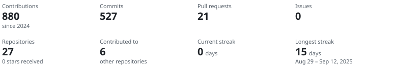

# Hi, I'm Irina 👋

**Full Stack Developer** · Antananarivo, Madagascar 🇲🇬

&nbsp;

&nbsp;

---

## `01` · About

Third-year Computer Science student at [HEI](https://www.hei.school/), focused on Full Stack development.
I like turning complex ideas into simple, robust web apps, from the database to the interface.
Currently learning AI integration and Elixir, and open to internships.

## `02` · Stack

## `03` · GitHub

<picture>
  <source media="(prefers-color-scheme: dark)" srcset="https://raw.githubusercontent.com/IrinaStephane/IrinaStephane/output/stats-dark.svg">
  <source media="(prefers-color-scheme: light)" srcset="https://raw.githubusercontent.com/IrinaStephane/IrinaStephane/output/stats.svg">
  
</picture>

<picture>
  <source media="(prefers-color-scheme: dark)" srcset="https://raw.githubusercontent.com/IrinaStephane/IrinaStephane/output/contributions-dark.svg">
  <source media="(prefers-color-scheme: light)" srcset="https://raw.githubusercontent.com/IrinaStephane/IrinaStephane/output/contributions.svg">
  
</picture>

<picture>
  <source media="(prefers-color-scheme: dark)" srcset="https://raw.githubusercontent.com/IrinaStephane/IrinaStephane/output/languages-dark.svg">
  <source media="(prefers-color-scheme: light)" srcset="https://raw.githubusercontent.com/IrinaStephane/IrinaStephane/output/languages.svg">
  
</picture>

---

*Start small. Innovate Madagascar. Then the world.* 🌍

