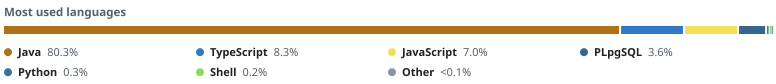

<h1 align="center">Hi 👋, I'm Irina</h1>
<h3 align="center">I'm currently a computer science student with a passion for web development, clean code, and well-organized projects. I enjoy learning by building, turning complex ideas into simple solutions, and collaborating on practical, real-world applications.
I'm curious, self-motivated, and always eager to improve my technical skills.</h3>

  

- 🔭 I’m currently working on [HEI](https://www.hei.school/)
- 🌱 I’m currently learning on Integration of AI in app
- 💬 Ask me about Next.js, React, TypeScript, Javascript

### 💻 What I enjoy  
- ⚛️ Web development (React, Tailwind, Git)  
- 📜 Writing simple and effective scripts  
- 🤝 Teamwork and hands-on projects  
- 🧹 Improving code clarity and structure

### 🌐 Connect with me:

---

## 🛠️ Languages and Tools

 

  
   
  
  
   
  

---

## 🎯 Values & Goals

- 🌍 Start small. Innovate Madagascar. Then the world.  
- 🔒 Build privacy-friendly, open, accessible tools  
- 🧠 Keep learning — from code, people, and purpose  
- ✨ Make a real-world impact through clean, thoughtful design

---

> _"Even small tools can inspire big change — starting from home."_

---

## 📈 GitHub

<picture>
  <source media="(prefers-color-scheme: dark)" srcset="https://raw.githubusercontent.com/IrinaStephane/IrinaStephane/output/stats-dark.svg">
  <source media="(prefers-color-scheme: light)" srcset="https://raw.githubusercontent.com/IrinaStephane/IrinaStephane/output/stats.svg">
  
</picture>

<picture>
  <source media="(prefers-color-scheme: dark)" srcset="https://raw.githubusercontent.com/IrinaStephane/IrinaStephane/output/contributions-dark.svg">
  <source media="(prefers-color-scheme: light)" srcset="https://raw.githubusercontent.com/IrinaStephane/IrinaStephane/output/contributions.svg">
  
</picture>

<picture>
  <source media="(prefers-color-scheme: dark)" srcset="https://raw.githubusercontent.com/IrinaStephane/IrinaStephane/output/languages-dark.svg">
  <source media="(prefers-color-scheme: light)" srcset="https://raw.githubusercontent.com/IrinaStephane/IrinaStephane/output/languages.svg">
  
</picture>

---

 
  

